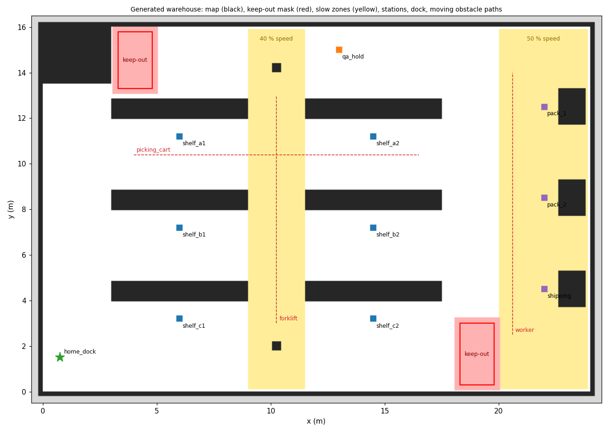
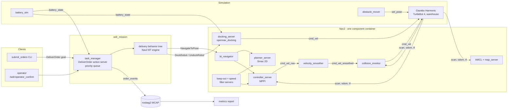
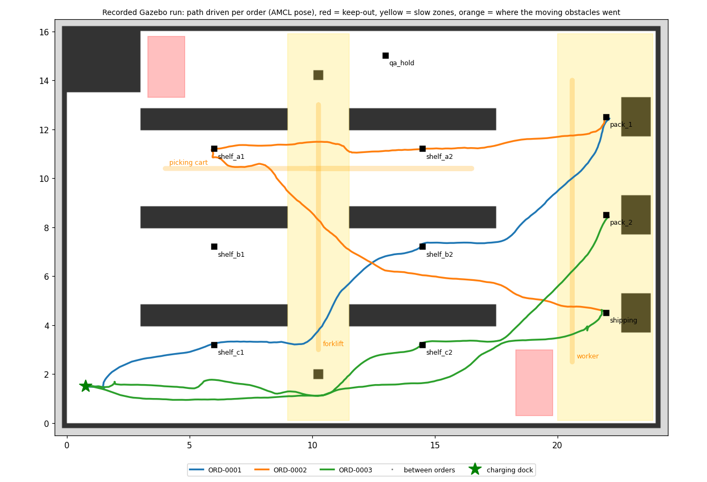
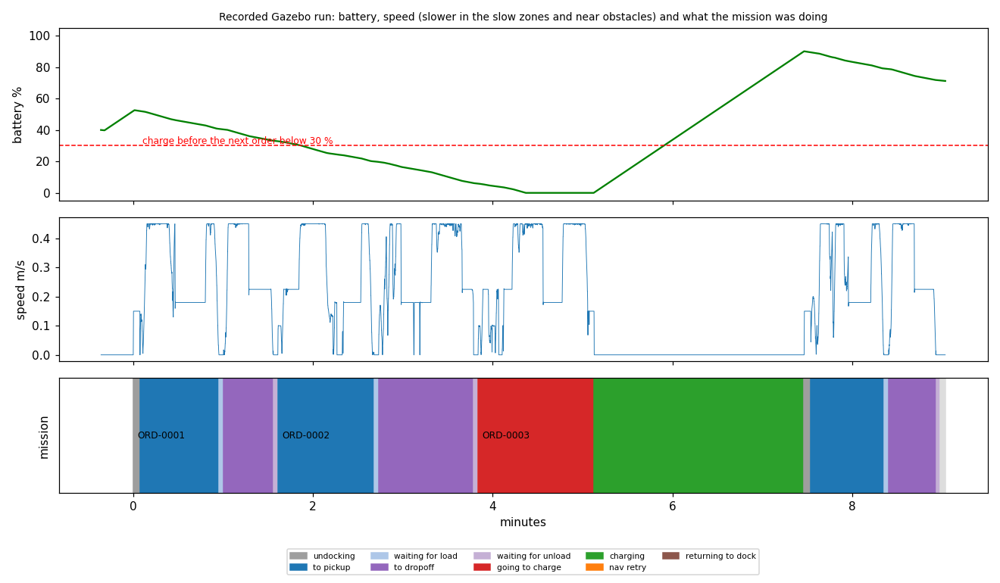
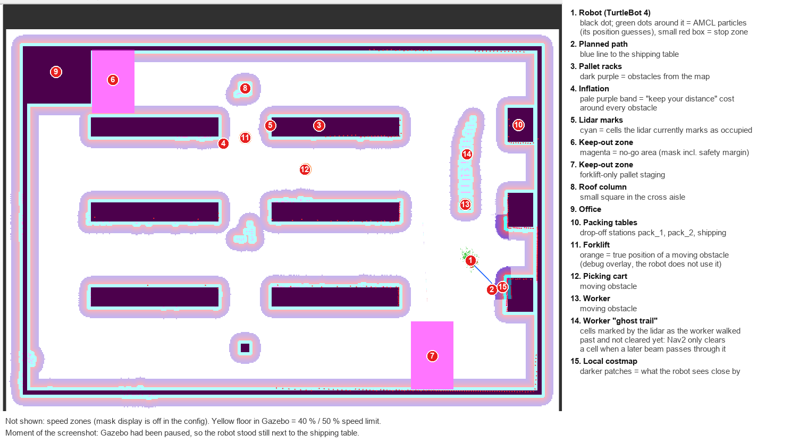

# warehouse-delivery-robot

[](https://github.com/Turnedone/warehouse-delivery-robot/actions/workflows/ci.yml)
[](LICENSE)

An autonomous warehouse delivery robot built the way a warehouse-automation team builds one:
on **ROS 2 Jazzy**, **Nav2** and **Gazebo Harmonic**, with the industry tools rather than
from-scratch algorithms. A TurtleBot 4 takes delivery orders from a queue, drives from pick-up
shelves to packing stations through a warehouse with keep-out and slow zones and a moving
forklift, waits for an operator to load and unload it, and goes back to its charger when the
battery runs low.



*The warehouse as the robot's stack sees it, rendered from the generated files
(`tools/render_layout.py`): occupancy map, keep-out zones (red, with the safety margin the mask
adds), slow zones, pick-up shelves (blue), drop-off stations (purple), the exception area, the
charging dock and the paths of the three moving obstacles.*

The companion project [robot-sim](https://github.com/Turnedone/robot-sim) implements the
underlying algorithms (kinematics, lidar, mapping, A*, pure pursuit, MCL, SLAM) from scratch;
this one is about integrating, configuring, testing and operating the standard stack.

## What it does

| Area | What | Tools | Docs |
|---|---|---|---|
| Simulation | 24 × 16 m warehouse, TurtleBot 4, moving forklift/cart/worker; world, map, masks and stations generated from one layout file | Gazebo Harmonic, ros_gz, xacro, Nav2 loopback simulator | [01-simulation](docs/01-simulation.md) |
| Navigation | Localization, planning, control, keep-out zones, slow zones, collision stop zone | Nav2: AMCL, Smac 2D, MPPI, costmap filters, collision monitor, lifecycle + composition | [02-navigation](docs/02-navigation.md) |
| Mission | `DeliverOrder` action, priority queue, cancel, delivery behavior tree with retries and failure handling | rclcpp_action, BehaviorTree.CPP v4 on Nav2's BT engine, custom BT plugins | [03-mission](docs/03-mission.md) |
| Docking & battery | Simulated battery, charge before an order when low, return to the charger when idle | opennav_docking, sensor_msgs/BatteryState | [04-docking-battery](docs/04-docking-battery.md) |
| Dynamic obstacles | Obstacles only the lidar knows about; avoid, wait, replan, retry | costmap obstacle layers, MPPI, collision monitor | [05-dynamic-obstacles](docs/05-dynamic-obstacles.md) |
| Observability | Every order state change as a message; rosbag2/MCAP recording; KPI report from a bag; RViz config | rosbag2, MCAP, RViz, Groot2 | [06-observability](docs/06-observability.md) |
| Engineering | colcon workspace, unit + launch_testing integration tests, CI, Docker dev container, clang-format/tidy | colcon, gtest, pytest, launch_testing, GitHub Actions, Docker | [07-engineering](docs/07-engineering.md) |

Problems found along the way and how each was tracked down: [engineering log](docs/engineering-log.md).
Interview-style questions with answers: [self-test](docs/self-test.md).

## Architecture



## Quick start (WSL2 Ubuntu 24.04 or Ubuntu 24.04)

Needs ROS 2 Jazzy with Gazebo Harmonic (`ros-jazzy-ros-gz`) and Nav2; `rosdep` installs the rest:

```bash
rosdep install --from-paths src --ignore-src -y --rosdistro jazzy
bash tools/wsl/build.sh                       # builds into ~/wdr_ws
source ~/wdr_ws/install/setup.bash
```

Run the warehouse (headless; add `rviz:=true` or `gui:=true` for windows):

```bash
ros2 launch wdr_bringup warehouse.launch.py record:=true bag_dir:=$HOME/wdr_bags/demo
```

In a second terminal, submit orders and watch them complete:

```bash
ros2 run wdr_tools submit_orders shelf_b2:pack_1 shelf_a1:shipping shelf_c2:pack_2
```

Force a low-battery dock (or start with `initial_battery:=0.25`):

```bash
ros2 service call /battery_sim/set_level wdr_interfaces/srv/SetBatteryLevel "{percentage: 0.2}"
```

After stopping the launch (Ctrl+C), the KPI report from the bag:

```bash
ros2 run wdr_tools metrics ~/wdr_bags/demo
```

To watch it with windows (Gazebo + RViz with status labels, five orders, a charge stop):
`bash tools/wsl/demo.sh`.

Useful launch arguments: `sim:=loopback` (Nav2's loopback simulator instead of Gazebo, fast),
`battery_drain_scale:=15 battery_charge_scale:=20` (see a charge cycle within minutes),
`operator_auto_confirm_s:=-1` (wait for a real `/wdr/operator_confirm`), `moving_obstacles:=false`.

Tests: `bash tools/wsl/build.sh --test`. Docker: `docker build -f docker/Dockerfile -t wdr .`.

## Results

**Gazebo scenario** (WSL2, real-time factor ≈ 1.0, AMCL, moving forklift/cart/worker): three orders
queued at once, battery starting at 40 % with 15× drain and 20× charging so a charge cycle happens
within the run. Report from the recorded bag (`ros2 run wdr_tools metrics`):

| | |
|---|---|
| orders | 3 delivered, 0 failed, 0 navigation retries |
| success rate | 100 % |
| deliveries per hour | 19.2 (includes one full charge stop) |
| mean time per order | 179.7 s (96.5 s, 133.6 s, and 308.9 s for the order that charged first) |
| distance driven | 108.5 m |
| near misses (< 0.35 m lidar range) | 3, closest approach 0.16 m |
| dock visits | 1: order 3 started at 6 % → docked → charged to 90 % → undocked → delivered |



*The path the robot drove in that run (AMCL pose), one colour per order. Order 3 (green) starts
by driving back to the dock to charge, then delivers shelf_c2 → pack_2. The paths avoid both
keep-out zones and swing around the moving obstacles' lanes.*



*The same run over time. The battery drops below 30 % during order 2, so order 3 begins with a
charge stop (red: driving to the charger, green: charging). The speed trace shows the slow zones
directly: the flat steps at 0.18 m/s and 0.225 m/s are the 40 % and 50 % limits from the speed
filter (top speed 0.45 m/s). Plots by `tools/plot_run.py` from the recorded bag.*

Order 3 shows the full low-battery path: `CHECKING_BATTERY → GOING_TO_CHARGE → CHARGING →
UNDOCKING → TO_PICKUP → … → DONE`. Simulated drain is exaggerated, so the battery reached 0 %
on the way to the dock; a real threshold would leave a reserve (see
[04-docking-battery](docs/04-docking-battery.md)).



*RViz during a run (`rviz:=true`), annotated: map, inflation, lidar marks, keep-out masks, the
robot with its AMCL particles and plan, and the moving obstacles. Item 14 is a "ghost trail":
cells the lidar marked as the worker walked past, cleared only when a later beam passes through.*

**Navigation check** (Gazebo, Nav2 goals only): four goals across the warehouse, all reached with
2–18 cm final error, 40 % and 50 % speed limits applied in the slow zones, no sample inside a
keep-out zone.

**Tests**: `colcon test` → 56 tests, 0 failures (unit tests, generated-file checks, and the
headless loopback end-to-end suite: reject, cancel, deliver, low battery → dock → charge →
deliver), locally and in GitHub Actions.

## Repository layout

```
src/wdr_interfaces   DeliverOrder action, OrderEvent, OperatorConfirm, SetBatteryLevel
src/wdr_mission      task manager, BT plugin nodes, delivery tree (behavior_trees/), unit tests
src/wdr_sim          battery simulator, obstacle mover, unit tests
src/wdr_bringup      launch/, config/ (Nav2, layout, bridge), generated maps/ and worlds/, urdf/, rviz/, tests
src/wdr_tools        submit_orders CLI, bag metrics, tests
tools/               WSL build/stop scripts, lint script
docker/, .devcontainer/, .github/workflows/
docs/                one document per subsystem, engineering log, self-test
```

## How it was built

Designed and built with an AI coding assistant (Claude), in the same WSL2 setup as robot-sim;
every result above comes from runs in that environment, and the engineering log records the
problems as they were found. MIT licensed.
